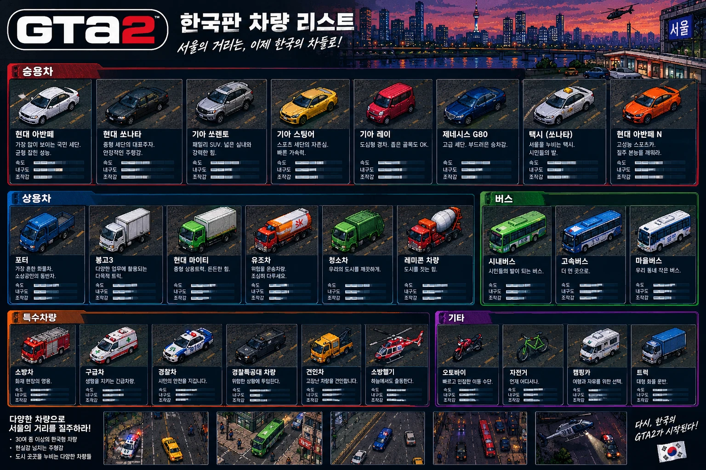
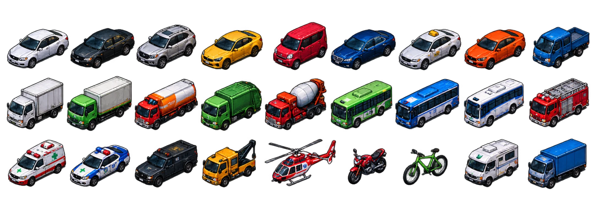
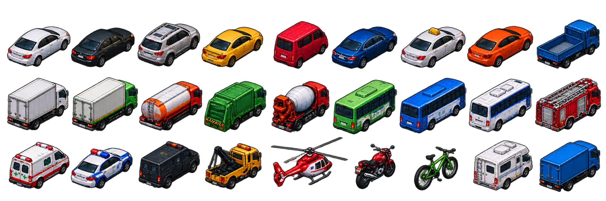

# 12. 차량 이미지 기준 (2.5D)

작성: 2026-10-12. 사용자가 이 이미지들처럼 차량을 만들어 달라고 요청했다 — **이미지 파일을 게임에 붙이지 않고, 참고만 해서 차종마다 코드로 만든다.** 이 문서는 참고 이미지 원본과, 차종별로 무엇을 보고 만들었는지를 정리한다.
관련: [03 차량](03_차량.md) · [09 법적 리스크](09_법적_리스크.md) · [10 비주얼 제작기준](10_비주얼_제작기준.md) · [11 2.5D 인계](11_Claude_인계_2.5D.md)

## 참고 이미지

### 차량 리스트 포스터

카테고리(승용 8 · 상용 6 · 버스 3 · 특수 6 · 기타 4 = 27종), 차종별 색, 사선 픽셀아트 질감을 참고한다.
**포스터에 있는 실존 상표(차명·제조사·GTA2 로고·SK 등)는 쓰지 않는다** — 게임 안 이름은 [09](09_법적_리스크.md)의 가칭이다 (아반떼 → 아벨라, 쏘나타 → 소나토 등).

### 27종 시트 — 앞모습 (진행 방향: 화면 왼쪽 아래)

### 27종 시트 — 뒷모습 (진행 방향: 화면 오른쪽 위)

두 시트는 Codex가 포스터를 참조해 생성한 재현물이다 (`assets/vehicles/reference_v1/`에 투명 PNG로도 있다). 이 폴더의 webp는 사용자가 보낸 그대로의 보관본이다. **게임은 어느 이미지도 불러오지 않는다** — 참고용이다.

## 차종별 모형 (`scripts/vehicle/vehicle_model.gd`)

시트 칸 순서대로, 참고 그림에서 따온 모양·색과 만든 방법. 색은 `data/vehicles/*.tres`의 `body_color`(차체)·`roof_color`(보조색)를 참고 그림에 맞췄다.

| 시트 칸 | 차종 (.tres) | 모양 |
|---|---|---|
| 흰 세단 | car_avela | 세단: 보닛·트렁크 경사 차체 + 유리 캐빈 + 지붕, 사이드미러, 앞뒤 등·번호판 |
| 검정 세단 | car_sonato | 세단 + 크롬 그릴·옆 크롬 줄 |
| 은색 SUV | car_sorea | 높은 차체·서 있는 유리·검정 하단 몰딩·지붕 가로대 |
| 노랑 스포츠 | car_striker | 낮은 차체·패스트백 유리·트렁크 날개·보닛 줄 |
| 빨강 경차 | car_rumi | 짧은 보닛·수직 유리·높은 박스 지붕 |
| 파랑 고급 세단 | car_zenith_g8 | 세단(긴 보닛) + 크롬 |
| 택시 | car_taxi | 흰 세단 + 노랑 지붕 표시등 |
| 주황 스포츠 | car_avela_r | 스포츠(짧은 유리) + 날개 |
| 파랑 소형 트럭 | trk_porta | 캡오버 캡 + 낮은 적재함(옆판·앞판·뒷문) |
| 흰 탑차 | trk_bongo | 캡 + 화물 상자(뒷문 두 짝·옆 골) |
| 초록 탑차 | trk_titan | 초록 캡 + 흰 화물 상자 |
| 유조차 | trk_tanker | 빨강 캡 + 흰·주황 원통 탱크 + 위 통로, 3축 |
| 청소차 | trk_garbage | 초록 캡 + 뒤로 낮아지는 적재함 + 노랑 경고 띠 투입구 |
| 레미콘 | trk_mixer | 빨강 캡 + 뒤로 들린 원뿔 드럼(흰·주황 나선) |
| 시내버스 | bus_city | 긴 상자 + 창 띠 + 오른쪽 앞문 + 행선지판 + 지붕 냉방기 |
| 고속버스 | bus_express | 파랑 버스 + 흰 띠 두 줄, 3축 |
| 마을버스 | bus_village | 흰 버스 + 파랑 띠 |
| 소방차 | sp_fire | 빨강 캡 + 은색 수납함 차체 + 지붕 사다리 + 경광등 |
| 구급차 | sp_ambulance | 짧은 보닛 승합 + 빨강 띠 + 초록 십자(옆·지붕) + 경광등 |
| 경찰차 | police_patrol | 흰 세단 + 남색·노랑 옆 띠 + 경광등(사이렌 때 깜빡임) |
| 특공대 | sp_swat | 검정 승합 + 작은 창 + 경광등 |
| 견인차 | sp_tow | 노랑 캡 + 데크 + 뒤로 솟은 붐·고리 + 주황 경광등 |
| 소방헬기 | sp_fire_heli | 119 구조헬기(2026-10-19 새 모형): 큰 쌍발 동체(빨강·흰 아래띠·노란 줄) + 둥근 유리 기수 + 옆 미닫이문 + 구조 윈치 + 흰 엔진 덮개 + 바퀴 착륙장치 + 탐조등·경광등 |
| (시트에 없음) | police_heli | 경찰 헬기: 민간 헬기 동체(남색) + 흰 띠·연두 띠 + 엔진 덮개 양옆 경광등 + 기수 밑 탐조등 |
| (시트에 없음) | army_spg | 번개 자주포(K9식): 무한궤도(띠·보기륜·구동륜·옆 덮개) + 낮은 차체(경사 앞판·조종수 해치) + 큰 포탑(지휘관 해치·기관총·연막탄·짐 바구니) + 긴 포신(방패·배연기·포구 제퇴기). 포탑(`Part.turret` 1)·포신(2, `trunnion`에서 들림)은 그릴 때 돌린다 |
| (시트에 없음) | army_jeep | 소형 전술차량: 각진 차체 + 짧은 앞유리 + 범퍼 가드 + 예비 타이어 + 지붕 기관총 거치대(포탑) + 큰 바퀴 넷, 얼룩무늬 |
| (시트에 없음) | heavy_excavator | 굴삭기: 무한궤도 + 선회 받침 + 상부(유리 운전실·엔진 덮개·평형추, 포탑) + 붐·암·버킷(관절 부품 `Part.joints`, 유압 실린더·버킷 이빨). 노란 차체 |
| (시트에 없음) | heavy_dozer | 불도저: 무한궤도 + 엔진 덮개·보호틀 운전실 + 앞 블레이드(관절 — 든다)·밀대·실린더 + 뒤 리퍼. 노란 차체 |
| (시트에 없음) | army_heli | 군 기동헬기: 국방색 각진 동체 + 짙은 유리 조종석 + 양옆 날개·로켓 포드 + 기수 기관총 + 큰 꼬리날개 + 바퀴 착륙장치 |
| 오토바이 | etc_bike | 두 바퀴 + 연료통·안장 + 배달 상자, 타면 헬멧 쓴 사람 |
| 자전거 | etc_bicycle | 초록 프레임 + 핸들, 타면 사람 |
| 캠핑카 | etc_camper | 승합 캡 + 운전석 위로 나온 거실 상자 + 창·문·띠 |
| 대형 화물 | etc_truck | 파랑 캡 + 긴 파랑 화물 상자, 3축 |
| (시트에 없음) | sp_army | 국방색 캡 + 천막 짐칸 |

## 만드는 방법

- 부품: 상자, 아래·위 넓이가 다른 경사 상자(앞유리·보닛), 원통(바퀴·탱크·드럼·동체), 막대(거울 팔·사다리·회전날개·자전거 틀). 창·등·띠·십자·문틈은 부품 면 위의 무늬(데칼).
- 트럭·버스·승합은 참고 그림처럼 키가 크다 (`height`: 버스 33~36, 탑차 31~36, 소방·군 30, 유조·레미콘 28 …). 이 투영에서는 지붕이 넓게 보이므로, 키가 낮으면 지붕이 잘린 상자처럼 보인다.
  지붕은 상자 위에 안으로 좁아지는 낮은 덮개(`crown`)를 얹어 모서리가 둥글게 꺾이게 한다 (트럭 캡·버스·승합·캠핑카·탑차).
- 차체·캐빈·캡은 세로 모서리를 깎아(bevel) 둥글게 보인다. 깎은 모서리에도 전조등·후미등·앞유리를 이어 붙여 감싼 모양을 낸다.
- 세부 (2차): 차체색 기둥이 있는 창(앞유리 빛 줄기·옆창 둘·뒷유리), 문틈·손잡이, 어깨선 빛, 바퀴 아치, 범퍼·흡기구·그릴 살·방향지시등·후진등, 알루미늄 휠(스포크)·철제 휠, 상어지느러미 안테나·선루프.
  트럭: 감싼 앞유리·차양·지붕 표시등·팔 달린 거울·발판, 옆 가드·연료통, 화물 상자 잠금 막대·경첩·반사띠. 버스: 행선지 LED·문 두 개·검은 창 띠·거울 팔·엔진 그릴.
  특수차: 소방 셔터 줄·호스 릴·경광등 막대, 유조차 테·맨홀·사다리, 레미콘 물탱크·홈통, 견인 쇠줄·바퀴 들어올림 팔, 특공대 선팅·범퍼 가드·지붕 짐대, 구급차 바둑판 띠, 헬기 유리 지붕·꼬리 회전날개·4장 날개, 자전거 바큇살.
- 좌표는 차 기준 3D(x 오른쪽, y 뒤, z 위)이고 크기는 차종의 충돌 크기(`size`)와 높이(`height`)에서 정한다 — 물리 크기와 그림이 맞는다.
- 회전한 차는 같은 모형을 돌려 비추므로 모든 각도가 자연스럽다 (4방향 이미지와 달리 회전 중간도 있다).
- 브레이크·후진·전조등·경광등은 차 상태에 따라 색이 바뀌고, 카센터 도색은 차체 색에 바로 반영된다. 터지면 같은 모형이 그을린다.
- 모습이 바뀔 때(회전·브레이크·경광등·연기 등)만 다시 그린다 — 곧게 달리는 차는 그림을 다시 만들지 않는다.
- 확인: `godot --path . res://tools/screenshot.tscn -- --only=iso` → `.screenshots/iso_vehicles.png` (28종을 네 방향으로 세운 것).
- 크게 보기 (Codex의 `tools/isometric_sample/vehicle_gallery`처럼 확대 도감): `godot --path . res://tools/vehicle_gallery.tscn` — ←/→ 돌리기, Space 자동 회전, B 브레이크등, S 경광등, 1·2 앞·뒤.
  저장은 `-- --shot` (`.screenshots/vehicle_gallery_front.png`·`_rear.png`), 몇 대만 더 크게는 `-- --shot --ids=car_sonato,bus_city --name=vehicle_closeup`.

## 남은 것

- 원본 그림의 곡면·픽셀 질감은 깎은 상자 조합으로 단순화했다. 로고·글자(택시·경찰·구급 표기)는 없다(상표 회피, 면 위 글자는 아직 못 그린다).
- 경찰 헬기(수배 ★5)는 아직 예전 원형 그림이다.
- 최종 픽셀 아트(M7)로 갈 때 이 모형을 기준 실루엣으로 쓸 수 있다.
