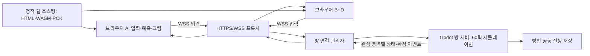

# 18. 웹 2~4인 멀티플레이 설계

작성: 2026-10-21. 상태: 코드 확인에 기반한 구현 제안. 멀티플레이 구현·서버 배포·성능 검증은 아직 하지 않았다.

## 1. 권장 형태와 범위

PC 브라우저에서 초대 코드로 들어오는 2~4인 협동 방을 만든다. Godot 전용 서버가 도시와 게임 결과를 결정하고, 각 브라우저는 자기 입력·카메라·그림·소리를 맡는다. 서버는 Linux headless 릴리스로 실행한다. 방장은 시작·미션 선택 권한을 가진 참가자이며 서버 역할은 하지 않는다.

첫 실험은 두 명의 도보 이동부터 시작한다. 최종 첫 협동 버전에는 4인 입장, 걷기·달리기·공격, 일반 차량 운전·동승, 공동 NPC·경찰 추격, 미션 1개, 재접속을 포함한다. 헬기·자주포·중장비·모든 부업·전체 캠페인 연동은 이 흐름을 통과한 뒤 확장한다. 미지원 기능은 멀티 방에서 명확히 비활성화한다.

아래 수치와 게임 규칙은 구현을 위한 기본 제안이다. 실제 지연과 CPU 측정에 따라 조정하며 측정된 성능으로 취급하지 않는다.

## 2. 배포 구조



초기는 작은 방 관리자 한 개와 방당 Godot 프로세스 하나를 사용한다. 프로세스 하나의 메인 SceneTree에서 여러 도시를 동시에 돌리는 구조는 피한다. 한 방의 느린 틱이나 종료가 다른 방에 영향을 주지 않게 한다. 방 관리자는 입장권 발급·프로세스 기동·상태 확인·라우팅만 맡고 게임 물리는 계산하지 않는다. 초기 방 수와 서버 사양은 부하 측정 후 정한다.

웹 자산은 HTTPS로 전달하고 게임 연결은 같은 도메인의 `/session/<room_id>` WSS 경로로 보낸다. 프록시가 WebSocket 업그레이드와 heartbeat보다 긴 idle timeout을 제공해야 한다. 기존 웹 스레드 빌드의 COOP/COEP 헤더도 유지한다. `tools/serve_web.py`는 로컬 미리보기용이고 방 서버나 운영 서버가 아니다.

## 3. 통신 방식: WSS로 작은 실험을 먼저 검증

초기 구현은 Godot의 WebSocketMultiplayerPeer를 사용한다. 브라우저와 Godot 전용 서버에서 같은 Godot 네트워크 기능을 사용하고, 메시지 내용은 별도 버전 스키마로 정의한다. 입장 관리용 HTTP 서비스가 Godot RPC를 직접 구현하지 않게 한다.

WebSocket은 TCP라 유실된 데이터가 뒤의 최신 이동 상태도 지연시킬 수 있다. 따라서 이를 최종 액션 게임에 적합하다고 미리 확정하지 않는다. 논리적인 메시지 종류나 RPC 채널을 나누어도 TCP의 대기 문제는 없어지지 않는다. WSS에서 unreliable 전송 효과를 기대하지 않는다.

이동 실험에서 RTT 80/150ms, 지터 30ms, 패킷 손실 1% 조건을 비교한다. 정상 네트워크는 통과해도 손실 조건에서 상태 큐가 지속 증가하거나 250ms 이상 오래된 위치가 자주 표시되면 차량·전투 확장 전에 WebRTC 서버 연결로 바꾼다. 이 경우 signaling, 필요 시 TURN, 네이티브 Godot 서버의 WebRTC 확장과 배포 절차가 추가된다. 첫 실험에서 두 전송을 동시에 구현하지 않는다.

전송 변경 범위를 줄이도록 `SessionTransport`가 연결/종료/메시지 송수신을 감싸고 시뮬레이션은 transport 클래스나 RPC 경로를 직접 참조하지 않는다. WebSocket은 안정적으로 도착해도 오래된 상태는 쓸모없으므로 아직 전송하지 않은 스냅숏은 최신 한 개만 남긴다. 이미 TCP 송신 큐에 들어간 데이터는 이 방식으로 취소할 수 없다. 큐 크기·가장 오래된 상태 나이를 함께 기록한다.

## 4. 현재 코드에서 바꿔야 하는 연결

| 현재 근거 | 현재 구조 | 필요한 분리 |
|---|---|---|
| `scripts/main.gd:114`, `:116`, `:126` | player·director·wallet 각 하나 | `PlayerRegistry`와 플레이어별 `PlayerSession`, 방별 `WorldSession` |
| `scripts/actors/player.gd:47` | 물리 처리 안에서 전역 Input 직접 읽음 | `LocalInput` → `InputCommand` → 동일한 이동 처리 함수 |
| `scripts/core/director.gd:20`, `:94` | current_vehicle 하나, 요청 즉시 탑승 | 플레이어별 제어 상태 + 서버의 차량 좌석 예약·확정 |
| `scripts/combat/player_weapons.gd:41`, `:93` | 로컬 입력·무기 상태·발사 결정을 함께 처리 | 입력 수집과 서버의 발사 가능 검사·발사 처리 분리 |
| `scripts/combat/combat.gd:47`, `:122` | player·director 한 쌍, by_player bool로 공격 출처 표시 | 모든 플레이어 검색 + `AttackContext(actor_id, team_id, action_id)` |
| `scripts/police/police_dispatcher.gd:86` | 수배 객체와 조종 대상 하나 | 방 수배 상태 + 참가자 목록에서 표적 선택 |
| `scripts/traffic/traffic_system.gd:131`, `:279` | 카메라 한 곳 중심으로 차량 생성·제거 | 서버의 여러 플레이어 관심 영역 합집합 |
| `scripts/actors/pedestrian_manager.gd:139` | 한 플레이어·카메라로 활성 영역 결정 | 복수 플레이어 주변 활성화와 전체 예산 |
| `scripts/main.gd:674`, `:717`, `scripts/core/save_game.gd` | 개인 슬롯 저장과 하나의 진행 상태 | 별도 멀티 저장 스키마와 서버 저장 책임 |

기존 싱글플레이는 `OfflineSession`이 같은 입력·시뮬레이션 인터페이스를 사용하도록 점진적으로 옮긴다. 플레이어 사전을 추가하면서 기존의 암묵적인 `main.player` 참조를 방치하지 않는다. 전투, 범죄 신고, 리스폰, 픽업, NPC 대화, 경찰 표적, 차량 소리, HUD까지 호출 지점을 점검한다.

## 5. 실행 책임과 노드 구성

제안 파일은 아직 생성하지 않는다.

```text
scripts/session/session_context.gd     # offline / server / client 역할
scripts/session/player_registry.gd     # player_id → 플레이어별 상태
scripts/session/input_command.gd       # 이동·조준·버튼 입력 데이터
scripts/network/session_transport.gd   # 연결과 송수신 인터페이스
scripts/network/room_client.gd         # 입장·동기화·재접속 상태
scripts/network/world_replication.gd   # 생성·제거·스냅숏·관심 영역
scripts/network/network_clock.gd       # 서버 틱과 표시 시각 추정
scripts/network/remote_actor_view.gd   # 원격 인물·차량 표시와 보간
scripts/server/room_server.gd          # 입장 검증·입력 처리·방 수명
scripts/server/vehicle_seats.gd        # 운전석·동승석·탑승 예약
scenes/server/room.tscn                # 그림 없이 도시 시뮬레이션
scenes/ui/multiplayer_lobby.tscn       # 방 만들기·코드 입장·준비
```

| 시스템 | 전용 서버 | 브라우저 |
|---|---|---|
| 플레이어·차량의 확정 위치·충돌 | 실행 | 자기 대상만 예측; 다른 대상은 보간 |
| NPC·교통·경찰 AI | 실행 | 실행하지 않고 모습 표시 |
| 발사·명중·피해·돈·미션 판정 | 결정 | 요청과 결과 연출 |
| 도시 배치·건물 충돌 | 공통 데이터로 구성 | 같은 데이터의 그림·예측용 정적 충돌 |
| 카메라·HUD·비·물·소리 | 생성하지 않음 | 자기 주변만 표시 |
| 공동 진행 저장 | 기록 | 요약 표시 |

현재 Main을 그대로 headless로 켜는 것만으로 서버 분리가 완료되지는 않는다. `City`의 물리·지도 생성과 `BuildingView`·조명·물 셰이더 생성을 분리해야 한다. 서버용 프리셋에서는 타이틀, 그림, 소리를 제외하고 물리 형태·NPC/차량 수치·미션 데이터는 남긴다.

## 6. 객체 식별과 권한

- `room_id`: 방 식별자. 초대 코드는 방을 찾는 짧은 별칭이며 인증 수단이 아니다.
- `player_id`: 방 안 참가자 식별자. 연결이 바뀌어도 재접속 동안 유지한다.
- `peer_id`: 현재 Godot 연결 식별자. 재접속하면 달라질 수 있다.
- `entity_id`: 서버가 생성하는 사람·차·투사체의 식별자. 해당 방 수명 동안 재사용하지 않는다.
- `world_epoch`: 방 로드/리셋 세대. 이전 세대의 메시지는 버린다.
- `server_tick`, `input_seq`, `action_id`, `state_revision`: 시간·입력 확인·중복 방지·상태 순서.

노드 경로·배열 인덱스·RID를 네트워크 ID로 사용하지 않는다. 서버는 연결에서 실제 player_id를 찾고 클라이언트가 보낸 소유자 ID를 신뢰하지 않는다. 좌표·체력·돈·명중 결과를 클라이언트가 확정해 보내지 못하게 한다. 데이터는 기본 숫자·문자열·명시된 배열/바이트로 제한하고 네트워크 객체 역직렬화는 허용하지 않는다.

## 7. 주기와 이동 표시

초기값은 서버 물리 60Hz, 입력 수집 60Hz, 입력 전송 최대 30회/초, 상태 전송 15회/초, 웹 표시 목표 30FPS다. 입력 메시지 하나에는 최대 두 개의 연속 입력 샘플을 묶는다. 클라이언트가 보낸 delta로 서버 시간이나 이동량을 늘리지 않는다.

자기 도보 캐릭터는 로컬에서 즉시 예측 이동한다. 서버는 마지막 반영 input_seq와 확정 위치를 보내며, 클라이언트는 그 상태에 미확인 입력을 재적용한다. 화면 오차는 짧게 보정하고 층 변경·리스폰·큰 오차는 즉시 맞춘다. 입력과 화면 좌표 변환을 분리해 서버가 클라이언트 카메라나 줌을 필요로 하지 않게 한다.

다른 플레이어와 NPC·차량은 약 100ms 뒤의 상태를 보간한다. 방향 각도는 짧은 회전 방향으로 보간한다. 최대 100ms만 제한적으로 외삽하고 업데이트가 더 오래 끊기면 정지/연결 불안정 표시로 바꾼다. 오래된 위치를 계속 밀어 이동시키지 않는다.

차량 운전자 예측은 서버와 같은 VehicleMotor를 사용하되 차체 충돌 결과를 결정론적으로 일치한다고 가정하지 않는다. 다른 차·사람을 친 결과와 피해는 서버가 확정하고 운전자의 표시 위치만 보정한다. 예측 차량이 원격 차를 실제 클라이언트 물리로 계속 밀어내지 않도록 표시 객체와 예측 충돌 대리체를 분리한다. 초기 도보 단계부터 이 경계를 확인한 뒤 차량을 넣는다.

애니메이션은 방향·행동 상태·속도·시작 틱으로 브라우저가 재생한다. 스프라이트 픽셀, 각 관절, 매 프레임 그림 번호는 전송하지 않는다.

## 8. 메시지 계약

| 메시지 | 주요 내용 | 처리 |
|---|---|---|
| HELLO / WELCOME | protocol_version, build_hash, content_hash, 입장권 | 버전·정원·입장권 검사 후 player_id 배정 |
| INPUT | epoch, input_seq, 샘플 틱, move, aim_world, held_buttons | 크기·범위·빈도 제한; 서버 입력 버퍼에 넣음 |
| ACTION | epoch, action_id, enter/exit/fire/interact, target_id | 서버가 거리·쿨다운·무기·좌석 확인 |
| SPAWN / DESPAWN | entity_id, kind_id, revision, 초기 상태 | 먼저 생성한 뒤 갱신; 영역 이탈은 세계 파괴와 구분 |
| SNAPSHOT | server_tick, baseline_id, last_input_seq, 변경 객체 | 위치·속도·층·방향·행동·체력·좌석 상태 반영 |
| EVENT | event_id, tick, 공격자·대상·결과 | 명중·사망·탑승·보상·미션 결과를 한 번만 처리 |
| WORLD_BEGIN / CHUNK / END | epoch, 기준 revision, 분할 초기 상태 | 전체 수신·검사·ACK 뒤 PLAYING 진입 |
| RESUME / RESYNC | 재접속 토큰, 마지막 revision | 유효한 참가자를 복구하고 새 초기 상태 전송 |

INPUT은 지속 상태만 담는다. 탑승·무기 교체·단발 발사·미션 수락 같은 한 번의 동작은 ACTION으로 보낸다. 같은 발사가 INPUT과 ACTION에서 두 번 처리되지 않게 한다. 연사는 서버가 눌림 상태·연사 간격으로 실행한다. 서버는 action_id의 제한된 중복 기록을 유지하고 확인 응답을 보내며, 재전송은 동일 ID를 사용한다.

초기 입장 중 발생하는 이벤트는 기준 revision 이후로 짧게 버퍼링한다. 클라이언트가 초기 상태 ACK를 보내면 그 이후 변경을 순서대로 적용한다. 버퍼가 넘치면 최신 초기 상태를 다시 보낸다. 알 수 없는 entity_id나 누락된 delta baseline은 재동기화 요청으로 복구한다. 표시 영역을 나간 객체의 오래된 갱신을 다시 생성 명령처럼 처리하지 않는다.

대용량 초기 상태는 분할하고 일반 스냅숏은 필드 마스크와 양자화된 바이너리 형식을 사용한다. 전송량·큐 임계값은 실제 엔티티 수로 측정해서 정한다. 상태가 250ms 이상 밀리면 delta 큐를 계속 쌓지 말고 연결 상태를 표시하고 최신 상태 재동기화를 시도한다.

## 9. 차량·전투·경찰의 공동 규칙

### 차량

서버가 차량별 `driver_id`, `passenger_ids`, `seat_capacity`, 좌석 예약 만료 시각을 관리한다. 같은 틱에 운전석 요청 두 개가 오면 서버 처리 순서로 한 명만 예약한다. 나머지에는 명시적인 실패 또는 동승석 선택 응답을 보낸다. 플레이어가 운전하는 차를 다른 참가자가 즉시 빼앗지는 못한다.

차종별 좌석 수·문 위치 데이터가 현재 없으므로 첫 구현은 허용 목록의 일반 승용차에 운전자 1명·동승자 1명만 지원한다. 4인은 차 두 대로 이동할 수 있다. 오토바이·특수차량에 임의 동승석을 만들지 않는다. 더 큰 차의 4인 탑승은 좌석 정의 뒤 확장한다. 첫 동승자는 공격하지 않고 탑승·하차만 한다.

하차 위치와 층은 서버가 검사한다. 폭발·침수는 모든 탑승자에게 적용하고 같은 플레이어에게 중복 피해가 가지 않게 한다. 연결 종료 시 입력을 0으로 만들고 차량은 서버가 브레이크를 적용해 세운다. 운전석 예약은 해제하며 정지 후 운전자를 안전하게 하차시킨다.

### 전투

첫 협동 버전은 플레이어 간 직접 피해를 끈다. 차량·폭발에 의한 아군 피해도 같은 팀 규칙으로 막아 예외가 생기지 않게 한다. NPC 피해와 차량 파괴는 서버가 처리한다. 공격자의 플레이어 ID는 범죄·보상·수배 처리까지 전달한다. 현재 by_player bool은 싱글 호환 어댑터에만 남기고 멀티 결과의 출처로 쓰지 않는다.

초기는 서버 현재 상태의 명중 판정과 즉시 로컬 발사 연출을 사용한다. 과거 위치로 되감는 지연 보상은 첫 버전에 넣지 않고, 높은 RTT에서 명중 체감이 나빠지는지 검증한다. 잽·스트레이트·훅의 단계·시작 틱은 서버가 확정한다.

### 경찰·미션·리스폰

첫 버전은 방 전체가 공유하는 수배 레벨을 사용한다. 경찰은 살아 있고 같은 접근 가능한 층/지역에 있는 참가자 중 표적을 정하며, 지나치게 자주 표적이 바뀌지 않도록 유지 시간을 둔다. 개별 플레이어가 따로 숨는다고 방 전체 별이 즉시 사라지지 않게 서버에서 방 도주 판정을 한다.

사망·체포는 해당 플레이어만 병원/경찰서에서 복귀시키며 다른 참가자의 게임은 계속된다. 전원 활동 불능이면 현재 미션을 실패 처리하고 안전 지점에서 재개한다. 방장이 고른 미션의 진행·완료·보상은 공동 상태로 처리한다. 돈·갱 존경도·장 개방·완료 미션은 방 공유, 체력·무기·탄약은 개인 상태다. 구매·보상은 서버에서 순서대로 처리해 공동 지갑이 음수가 되거나 보상이 중복되지 않게 한다.

## 10. 멀리 떨어진 플레이어와 웹 성능

네 명이 각자 다른 구역으로 가면 서버 작업과 전송량이 늘어난다. 현재 카메라 하나만 보고 NPC를 치우는 함수를 그대로 쓰면 다른 플레이어 앞의 차가 사라진다. 서버에는 카메라 대신 살아 있는 모든 참가자·탑승 차량의 위치가 필요하다.

월드를 공간 셀로 나누고 플레이어별 활성 영역의 합집합에서 AI와 교통을 생성한다. 전체 방의 차량·NPC 예산을 정하고 서로 멀어져도 예산이 네 배로 무제한 증가하지 않게 한다. 모든 영역에 최소 수를 배분하고 남은 예산을 나눈다. 미션 대상·추격 중 경찰·탑승 차량·비행 중 투사체는 일반 거리 제거에서 보호한다. 구체적인 전체 상한은 4인이 흩어진 서버 부하 시험에서 결정한다.

클라이언트에는 자기 주변의 관련 객체만 전송한다. 동료 위치는 멀어도 낮은 빈도로 보내 미니맵에 표시한다. 탄환·폭발·추격 관련 객체는 화면 경계보다 넓은 완충 영역으로 구독하고 진입·이탈 경계에 여유 폭을 둬 객체가 반복 생성되지 않게 한다.

현재 웹 시작 장면은 이전 측정에서 약 29FPS다. 서버로 AI를 옮겨 줄일 수 있는 것은 브라우저 계산 일부이고, 건물 그리기 비용은 별도로 남는다. 멀티플레이 도입만으로 60FPS가 된다고 가정하지 않는다. 먼저 도보 2인에서 프레임 예산과 입력 지연을 확인하고, 건물 호출 병합/캐시 개선을 병행한다.

## 11. 방 수명·재접속·저장

방 상태는 `CREATING → LOBBY → SYNCING → PLAYING → CLOSING`이다. 정원은 접속 중·재접속 예약 슬롯을 합쳐 4명이다. 초대 코드로 방을 찾은 후 관리자가 짧은 유효기간의 1회 입장권을 발급하고, 서버가 실제 연결에 묶는다. 반복 입장 시도는 제한한다.

방장 시작 권한은 남아 있는 참가자 중 가장 먼저 들어온 사람에게 넘길 수 있다. 서버 시뮬레이션을 참가자 브라우저로 이전하지 않는다. 게임 중 새 입장은 초기 상태 동기화 이후 안전 지점에서 허용한다.

연결이 끊기면 플레이어를 무적/투명으로 바꾸지 않는다. 입력이 0.5초 이상 갱신되지 않으면 정지 입력을 적용한다. 재접속 슬롯은 30초 유지하고, 그동안 서버의 피해·체포 처리는 계속한다. 브라우저 탭이 배경으로 가면 입력·네트워크 처리가 멈출 수 있으므로 복귀 시 새 상태를 받는다. 무기 발사 눌림이 영구 유지되지 않게 입력 lease를 사용한다.

재접속은 별도의 추측하기 어려운 토큰으로 확인한다. 토큰이 같더라도 이전 연결을 무효화한 뒤 하나의 새 연결만 인정한다. 브라우저의 기존 개인 슬롯은 공동 진행의 근거로 사용하지 않는다.

멀티 전용 저장 `version`, `session_id`, `content_hash`, 공동 돈/존경도/장/미션/은신처, 참가자별 장비를 서버에 기록한다. 미션 완료·주요 구매 후와 주기적으로 임시 파일 작성→원자 교체한다. 빈 방은 60초 유예 후 저장하고 종료한다. 초기에는 방별 로컬 저장과 재시작 복구를 지원하며, 계정 간 영구 성장·상점·서버 이중화는 별도 단계다. 재접속 토큰은 만료·폐기하며 저장 파일에 평문 장기 자격 증명을 남기지 않는다.

서버 장애 시 마지막 저장 이후 진행 일부가 유실될 수 있다. 이를 UI에 알리고 브라우저가 임의로 세계를 계속 확정하지 않게 한다.

## 12. 구현 순서와 통과 조건

| 단계 | 구현 | 다음 단계로 넘어가는 조건 |
|---|---|---|
| 1. 입력·역할 분리 | LocalInput/InputCommand, OfflineSession, 플레이어 등록부 | 기존 싱글 조작·테스트 유지, 원격 표시 캐릭터가 Input을 읽지 않음 |
| 2. 2인 이동 실험 | 전용 서버, 방 입장, 이동 예측·보간, 상태 측정 | 두 브라우저가 서로 다른 입력으로 이동; 서버 위치 일치; 통신 지연/손실 게이트 통과 |
| 3. 4인 방 | 정원·초기 동기화·재접속·방장 권한 이전 | 5번째 입장 거부, 늦은 입장·탭 복귀·재접속 복구 |
| 4. 일반 차량 | 서버 좌석·운전 예측·동승·안전 하차 | 같은 운전석 중복 탑승 불가; 폭발·침수·운전자 이탈 일관성 |
| 5. 공동 전투·추격 | 공격 출처, 피해, 공통 수배, 리스폰, 미션 1개 | 중복 발사/피해/보상 없음; 같은 미션 결과 확인 |
| 6. 운영 준비 | 저장·버전 검사·HTTPS/WSS·부하 시험 | 서버 재시작 복구, 서로 다른 망의 4인 30분 플레이, 틱·메모리·전송 큐 안정 |

성능 목표(아직 미검증): 서버 60틱에서 틱 처리 p95 12ms 이하, p99 16.7ms 이하; 웹 30FPS 기준 프레임 p95 40ms 이하를 시작점으로 삼는다. 4인이 흩어지고 추격·차량 폭발이 겹치는 경우도 별도 기록한다. 입장 로딩과 정상 플레이 측정은 구분한다. 장기 누적 메모리 증가와 WebSocket 전송 큐의 증가가 없어야 한다.

필수 재현 시나리오: 동시 운전석 요청, 공격자 직후 퇴장, 재전송된 발사 action_id, 탄약 소진, 고가 위/아래 서로 다른 층, 연결 끊긴 운전자, 전원 사망, 미션 완료 직전 입장, 방장 퇴장, 네 명이 다른 구역으로 이동, 잘못된 빌드 접속, 30초 이후 재접속, 초기 상태 전송 도중 서버 상태 변경.

코드 구현 때 프로젝트의 필수 회귀 검증과 창 모드 확인을 함께 수행한다. 이전 웹 작업에서 traffic/police 테스트는 각각 300초 제한으로 끝내지 못했으므로, 이를 기존 통과 결과로 간주하지 않는다.

## 13. 이번 설계에서 확인한 것과 남은 것

현재 코드의 단일 플레이어·조종권·전투·수배·저장·거리 기반 생성 구조와 Godot 공식 웹/네트워크 문서를 확인했다. 이번 변경은 이 문서 한 개뿐이며 네트워크 코드, 프로젝트 설정, 데이터, 저장 파일은 바꾸지 않았다. 테스트·서버 기동·멀티 연결은 수행하지 않았다.

실제 서버 비용·수용 방 수·회선별 지연은 아직 산정하지 않는다. 게임 규칙은 1절·9절의 기본 제안으로 시작하고 플레이테스트 결과에 따라 바꾼다. 가장 먼저 구현할 것은 12절의 입력·역할 분리와 2인 이동 실험이다.

## 근거 문서

- [Godot 고수준 멀티플레이](https://docs.godotengine.org/en/stable/tutorials/networking/high_level_multiplayer.html): MultiplayerPeer 계열과 Godot 연결 관리.
- [WebSocket 사용](https://docs.godotengine.org/en/stable/tutorials/networking/websocket.html): 브라우저 지원과 TCP에 따른 지연 제약. WSS 선택의 액션 게임 적합성은 초기 실험에서 검증한다.
- [WebSocketMultiplayerPeer](https://docs.godotengine.org/en/stable/classes/class_websocketmultiplayerpeer.html): Godot 고수준 멀티플레이 연결에 사용하는 WebSocket peer.
- [웹 내보내기](https://docs.godotengine.org/en/stable/tutorials/export/exporting_for_web.html): 웹 네트워크·스레드 헤더·비활성 탭 제약.
- [전용 서버 내보내기](https://docs.godotengine.org/en/stable/tutorials/export/exporting_for_dedicated_servers.html): headless와 전용 서버 프리셋, 시각 리소스 제거.
